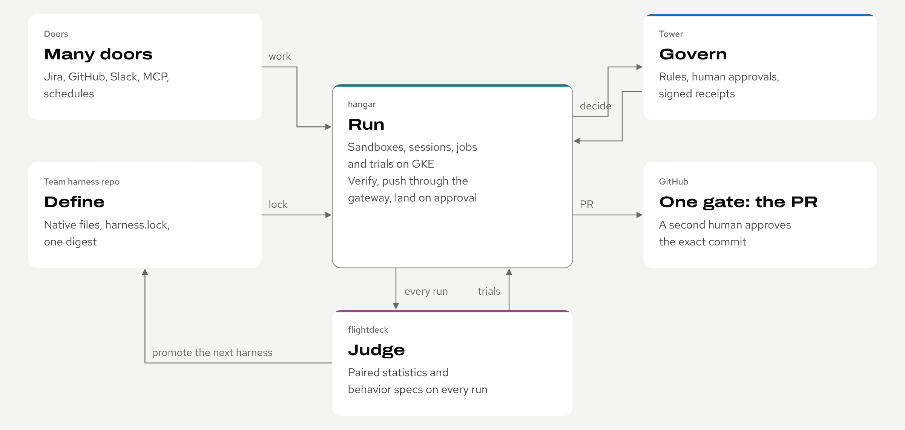
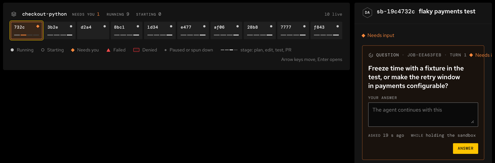

<picture>
  <source media="(prefers-color-scheme: dark)" srcset="brand/agent-factory/banner-dark.svg">
  
</picture>

# Agent factory

**Hand work to cloud coding agents and keep every change reviewable.** A team of six engineers runs about sixty agent sessions at once, and every change still leaves through a pull request a human approves.

Start with the docs: <https://sean-koval.github.io/agent-factory/> ([How it fits](https://sean-koval.github.io/agent-factory/how-it-fits/) follows one ticket through every tool; the [deck](https://sean-koval.github.io/agent-factory/deck/) tells it in fourteen slides).

<picture>
  <source media="(prefers-color-scheme: dark)" srcset="docs/assets/diagrams/slide-planes-dark.png">
  
</picture>

Four planes, five tools and the team harness repo.

| Tool | Plane | In one line | Repo |
| --- | --- | --- | --- |
| Team harness | Define | What the agents run, as native files and a lock frozen from a good run. | [team-harness](https://github.com/Sean-Koval/team-harness) (public example) |
| hangar | Run | Coding agents in isolated cloud sandboxes, from a ticket to a landed PR. | [hangar](https://github.com/Sean-Koval/hangar) |
| flightdeck | Judge | Harness changes judged with paired statistics and behavior specs over every run. | [flightdeck](https://github.com/Sean-Koval/flightdeck) |
| Tower | Govern | One decision point for risky actions: rules, human approvals, signed receipts. | Private (Sean-Koval/tower) |
| ai-dlc | Setup | Engineers' machines, the optional workflow plugin, local work gated on CI. | [ai-dlc](https://github.com/Sean-Koval/ai-dlc) |
| Spaceport | Also in the suite | Reviewed data products that agents query through four MCP tools (frozen). | Private (Sean-Koval/spaceport) |

<picture>
  <source media="(prefers-color-scheme: dark)" srcset="docs/assets/captures/hangar-fleet-needs-you.png">
  
</picture>

*hangar's Fleet, from its own demo: ten agents at work, one needs you. Every capture in the docs and the deck is taken from a product's demo by `scripts/captures.py`, never drawn.*

## What lives here

This repository is the suite-level home: the docs site, the deck, the diagrams and **Airframe**, the design system every tool's docs site and console uses.

| Path | What it is |
| --- | --- |
| `airframe/` | Airframe's source of truth: tokens, component CSS, icons, component docs and the brand book. See [`airframe/README.md`](airframe/README.md). |
| `theme/` | Generated from `airframe/` by `scripts/airframe.py build`; never edited by hand. `CHANGELOG.md` has one `theme-vN` entry per release. |
| `brand/` | Each product's banner, social preview, favicon and mark, generated by `scripts/banners.py`. See [`brand/README.md`](brand/README.md). |
| `docs/` | The suite site: overview, how it fits, architecture, contracts, flows, decisions, glossary. |
| `docs/assets/diagrams/`, `docs/assets/captures/` | Diagrams from `scripts/diagrams.py`; product captures and their crops from `scripts/captures.py`. |
| `deck/src.html` | The deck source; `scripts/build_deck.py --pdf` builds the slides and the PDF. |
| `roadmap.toml` | Which issues, across the tool repos, deliver each roadmap theme; `scripts/roadmap.py` renders the page daily. |
| `examples/company-overlay/` | The four repos a company holds to run the factory on its own cluster, placeholders only. See [Run the factory at your company](https://sean-koval.github.io/agent-factory/work/). |
| `examples/symphony-bot/` | A Symphony bot template that calls hangar's MCP for the person asking. No company values. |
| [team-harness](https://github.com/Sean-Koval/team-harness) | The public example team harness, in its own repo so channels resolve through its history. Fork it to start yours. |

hangar, flightdeck and ai-dlc are open source. Tower and Spaceport are private repositories for now.

## For maintainers

### Build locally

```sh
pip install zensical==0.0.71 playwright fonttools uharfbuzz pillow
python3 scripts/airframe.py build && python3 scripts/airframe.py check   # Airframe theme/ from airframe/
python3 scripts/diagrams.py && python3 scripts/render.py   # SVG + PNG diagrams
python3 scripts/banners.py --png                           # brand/: banners, social previews, favicons, marks
python3 scripts/captures.py --crops                         # re-cut the named crops from the captures
python3 scripts/build_deck.py --pdf                         # deck and PDF
sh scripts/build_site.sh && python3 -m http.server -d site  # the site (fetches roadmap data)
python3 -m unittest discover -s tests                       # tests
```

The site build reads public issue state from GitHub for the roadmap. Set `GITHUB_TOKEN` to raise the rate limit, or `ROADMAP_ARGS=--offline` to skip it. The Pages workflow rebuilds and republishes daily.

### Theme changes

Edit `airframe/tokens.json` or `airframe/styles/` and run `python3 scripts/airframe.py build`. Keep token names (rename only with an alias) and add a `## theme-vN` entry to `theme/CHANGELOG.md` listing each changed token; the `theme` workflow refuses a theme change without one.

Merging to `main` tags `theme-vN` and publishes a release. With a cross-repo GitHub App token (variable `THEME_SYNC_APP_ID`, secret `THEME_SYNC_APP_KEY`; tokens last an hour, nothing long-lived is committed) the workflow also opens a sync PR in hangar, flightdeck, ai-dlc and Tower. Without one, any maintainer with `gh` logged in runs the sync:

```sh
sh scripts/theme_sync.sh            # newest tag, every tool repo; or: sh scripts/theme_sync.sh theme-v2 hangar
```

Each tool repo can also pull a tag itself with `sh scripts/sync-airframe.sh theme-vN`.

Licensed under Apache-2.0.
