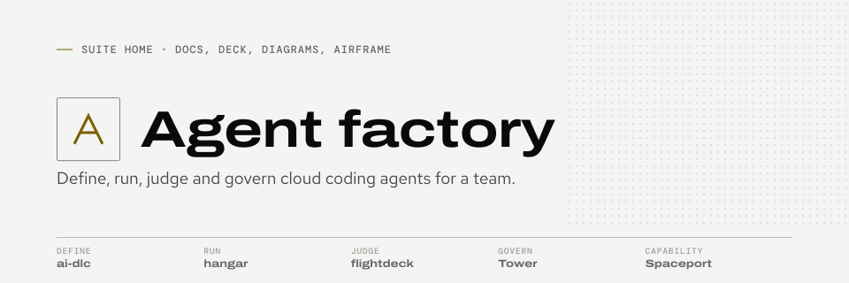

<picture>
  <source media="(prefers-color-scheme: dark)" srcset="brand/agent-factory/banner-dark.svg">
  
</picture>

# Agent factory

The suite-level home for Sean's team tooling for cloud coding agents: the docs site, the introduction deck, the architecture diagrams and **Airframe**, the design system every tool's docs site and console uses.

- Docs: <https://sean-koval.github.io/agent-factory/>
- Deck: <https://sean-koval.github.io/agent-factory/deck/slides/> (PDF and diagrams on <https://sean-koval.github.io/agent-factory/deck/>)
- Roadmap: <https://sean-koval.github.io/agent-factory/roadmap/> (rebuilt daily from issue state)
- Airframe: <https://sean-koval.github.io/agent-factory/airframe/> (tokens, components, icons, gallery)

| Tool | Plane | In one line | Repo |
| --- | --- | --- | --- |
| hangar | Run | Runs coding agents in isolated cloud sandboxes, from a ticket to a landed PR. | [Sean-Koval/hangar](https://github.com/Sean-Koval/hangar) |
| flightdeck | Judge | Judges harness changes with paired statistics and behavior specs over every run. | [Sean-Koval/flightdeck](https://github.com/Sean-Koval/flightdeck) |
| Tower | Govern | One decision point for risky actions: rules, human approvals, signed receipts. | Private repository (Sean-Koval/tower); docs site once public |
| Team harness | Define | The harness as native files and a lock, frozen from a good run and promoted on evidence. | [Sean-Koval/team-harness](https://github.com/Sean-Koval/team-harness) (the public example) |
| ai-dlc | Supports Define | Authors the optional workflow plugin, provisions machines, gates local work on CI. | [Sean-Koval/ai-dlc](https://github.com/Sean-Koval/ai-dlc) |
| Spaceport | Capability (frozen) | Reviewed data products that agents query through four MCP tools. Frozen. | Private repository (Sean-Koval/spaceport); README only |

Define is the team harness repo: native files and `harness.lock`, frozen from a good hangar run. ai-dlc contributes the optional workflow plugin and machine setup. [How it fits](https://sean-koval.github.io/agent-factory/how-it-fits/) follows one ticket through all of them.

## What lives here

| Path | What it is |
| --- | --- |
| `airframe/` | **Airframe's source of truth**: `tokens.json` (every color, font and size), the component CSS, icons, component docs and the brand book. See [`airframe/README.md`](airframe/README.md). |
| `theme/airframe.css`, `theme/airframe-components.css`, `theme/airframe-icons.svg`, `theme/airframe.js`, `theme/airframe-tokens.json` | Generated from `airframe/` by `scripts/airframe.py build`; never edited by hand. Tokens (`--af-*`), the `af-` component classes, the icon sprite, the optional helpers module, and tokens for scripts. |
| `theme/airframe-docs.css` | Maps the docs theme onto Airframe tokens. Each tool vendors what it needs with its `scripts/sync-airframe.sh`. |
| `theme/CHANGELOG.md` | One `theme-vN` entry per theme change, listing each token. Merging an entry tags `theme-vN` and starts the sync to the tool repos. |
| `brand/` | Each product's README banner (Night and Day), social preview, favicon and header mark, generated from Airframe by `scripts/banners.py`; tool repos vendor theirs with `scripts/sync-brand.sh`. See [`brand/README.md`](brand/README.md). |
| `docs/` | The suite site: overview, architecture (C4), contracts, flows, decisions, glossary. |
| `docs/assets/diagrams/` | Theme-aware SVG diagrams and PNGs in both themes, generated by `scripts/diagrams.py`. |
| `roadmap.toml` | Themes for the roadmap page: which issues, across the tool repos, deliver each outcome. `scripts/roadmap.py` turns it and live issue state into `generated/roadmap.md` (built in CI, never committed). |
| `deck/src.html` | The deck source; `scripts/build_deck.py --pdf` builds `deck/index.html` and the PDF. |
| [Sean-Koval/team-harness](https://github.com/Sean-Koval/team-harness) | The public example team harness (OpenSpec, GitHub + Projects, Jira, Splunk, GKE) with `harness.lock`, channels, the ai-dlc workflow plugin as a candidate, and CI, in its own repo so channels resolve through its history. Fork it to start your own. (`examples/team-harness/` is now a pointer.) |

## Build locally

```sh
pip install zensical==0.0.71 playwright fonttools uharfbuzz
python3 scripts/airframe.py build && python3 scripts/airframe.py check   # Airframe theme/ from airframe/
python3 scripts/diagrams.py && python3 scripts/render.py   # SVG + PNG diagrams
python3 scripts/banners.py --png                           # brand/: banners, social previews, favicons, marks
python3 scripts/build_deck.py --pdf                         # deck and PDF
sh scripts/build_site.sh && python3 -m http.server -d site  # the site (fetches roadmap data)
python3 -m unittest discover -s tests                       # tests
```

The site build reads public issue state from GitHub for the roadmap; set `GITHUB_TOKEN` to raise the rate limit, or `ROADMAP_ARGS=--offline` to skip it. The Pages workflow rebuilds and republishes daily.

Theme changes: edit `airframe/tokens.json` or `airframe/styles/` and run `python3 scripts/airframe.py build` (or edit `theme/airframe-docs.css`), keep token names (rename only with an alias), and add a `## theme-vN` entry to `theme/CHANGELOG.md` listing each changed token; the `theme` workflow refuses a theme change without one. Merging to `main` tags `theme-vN`, publishes a release and opens a sync PR in hangar, flightdeck, ai-dlc and Tower when the workflow has a cross-repo GitHub App token (variable `THEME_SYNC_APP_ID`, secret `THEME_SYNC_APP_KEY`; tokens last an hour, nothing long-lived is committed). Without one, the run's summary gives the one-command sync, which any maintainer with `gh` logged in can run:

```sh
sh scripts/theme_sync.sh            # newest tag, every tool repo; or: sh scripts/theme_sync.sh theme-v2 hangar
```

Each tool repo can also pull a tag itself with `sh scripts/sync-airframe.sh theme-vN`.

Licensed under Apache-2.0.
