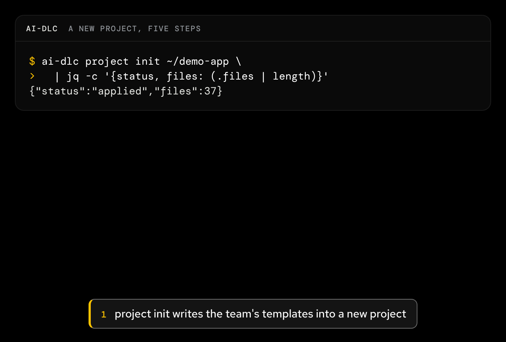

<span class="af-eyebrow">Airframe</span>

# Docs sites

What `airframe-docs.css` does to a docs page on its own, and the page patterns an author adds from Markdown.

Every pattern on this page is live and ships in that one file, so it looks the same on every site at the same `theme-vN`. [The docs sites](index.md#the-docs-sites) has the wiring in full.

## Wire a site

<div class="af-steps" markdown>
1. **Vendor the files.** `sh scripts/sync-airframe.sh theme-vN` copies the two stylesheets and the two partials.
2. **Load them.** `extra_css` lists `airframe.css`, `airframe-docs.css`, then the site's own `product.css`.
3. **Name the product.** `extra.airframe.product: hangar` marks the current item in the suite strip.
4. **Own one template.** `overrides/main.html` includes the strip and the footer.
</div>

The patterns need two Markdown extensions, `attr_list` and `md_in_html`.

## What a page gets without a class

- **Type.** One scale: the title, `##` with a rule above it, `###` in the body face, and labels below that.
- **Lede.** The first paragraph under the title. An `af-eyebrow` span above the title names the section.
- **Measure.** Paragraphs and lists stop at 36rem. Tables, figures, grids and code use the full column.
- **Tables.** Open rows, flush with the text. On phones a table of three or more columns scrolls inside its own frame.
- **Fact sheets.** A table with an empty header row loses the header, and its first column becomes the key.
- **Captions.** Every `figcaption` is a muted sentence, left-aligned under its picture.
- **Clips.** A still that links to an `.mp4` carries a Play label.

## Actions

`af-actions` is a row of buttons that wraps with one even gap. One of them is primary.

<div class="af-actions" markdown>
[Open the gallery](gallery/){ .md-button .md-button--primary } [Tokens](tokens.md){ .md-button } [Registry](registry.md){ .md-button }
</div>

```markdown
<div class="af-actions" markdown>
[Open the gallery](gallery/){ .md-button .md-button--primary } [Tokens](tokens.md){ .md-button }
</div>
```

## Tiles

`af-tiles` is a grid of link cards for a landing page or a section index. Each `af-tile` takes a bold title and a sentence. A leading image, a `<small>` label and an `*italic*` foot are optional.

<div class="af-tiles af-tiles--3">
<a class="af-tile" href="../tools/hangar/"><small>Run</small><strong>hangar</strong> From a ticket to a landed pull request. <em>Tool page</em></a>
<a class="af-tile" href="../tools/flightdeck/"><small>Judge</small><strong>flightdeck</strong> Paired statistics on every harness change. <em>Tool page</em></a>
<a class="af-tile" href="../tools/workspace/"><small>Govern</small><strong>Tower</strong> One decision point for risky actions. <em>Tool page</em></a>
</div>

```markdown
<div class="af-tiles af-tiles--3" markdown>
[<small>Run</small> **hangar** One sentence. *Tool page*](hangar.md){ .af-tile }
[**Concepts** A tile needs only a title and a sentence.](concepts.md){ .af-tile }
</div>
```

`af-tiles--2`, `--3` and `--4` fix the column count from 760px up; without one the tiles fill the row. `af-tools` takes the same three modifiers for its product tiles.

## Steps and phases

`af-steps` turns an ordered list into a numbered procedure on a rail, as in "Wire a site" above.

```markdown
<div class="af-steps" markdown>
1. **Install.** `pip install hangar`
2. **Sign in.** `hangar login` opens the browser.
</div>
```

`af-phases` groups a numbered sequence into phases, for a workflow at a glance. It is plain HTML: a name, an optional note and the steps.

<div class="af-phases">
<div class="af-phase"><b>Plan</b><small>Before any code</small><ol><li>Write the brief</li><li>Agree the checks</li></ol></div>
<div class="af-phase"><b>Build</b><small>In a sandbox</small><ol start="3"><li>Run the job</li><li>Review the diff</li></ol></div>
<div class="af-phase"><b>Land</b><small>Through the gate</small><ol start="5"><li>Approve the push</li><li>Merge the pull request</li></ol></div>
</div>

```html
<div class="af-phases">
<div class="af-phase"><b>Plan</b><small>Before any code</small><ol><li>Write the brief</li></ol></div>
<div class="af-phase"><b>Build</b><ol start="2"><li>Run the job</li></ol></div>
</div>
```

## Figures

`af-figure` fills the column. `af-figure--lead` is the screenshot a page leads with, linked to the full capture. `af-figure--frame` puts the same hairline on any other capture.

<figure class="af-figure af-figure--frame">


<figcaption>A framed capture. Only the picture for the page's theme is shown.</figcaption>
</figure>

`af-figure--tile` crops each poster in a row to the same 4:3 window, whatever the capture's shape.

<div class="grid" markdown>
<figure class="af-figure af-figure--frame af-figure--tile">


<figcaption>A tall capture.</figcaption>
</figure>
<figure class="af-figure af-figure--frame af-figure--tile">

<figcaption>A wide capture.</figcaption>
</figure>
</div>

`af-figure--bleed` lets a wide drawing run into the margin on a page that hides "On this page". `af-only-wide` and `af-only-narrow` show an element from 960px up, or only below it.

## Tables

Wrap a long reference table in `af-table--compact` for tighter rows.

<div class="af-table--compact" markdown>

| Class | Columns from 760px | Below 760px |
| --- | --- | --- |
| `af-tiles` | As many as fit | As many as fit |
| `af-tiles--2` | Two | As many as fit |
| `af-tiles--3` | Three | As many as fit |
| `af-tiles--4` | Four, two until 1100px | As many as fit |

</div>

Wrap an index table in `af-table--stack` and each row stacks on phones, the first cell as its name. Narrow this window to see it.

<div class="af-table--stack" markdown>

| Page | Answers | Reader |
| --- | --- | --- |
| [Tokens](tokens.md) | Which value do I use? | Anyone writing CSS |
| [Components](components.md) | Which part fits this screen? | UI builders |
| [Registry](registry.md) | How do I install it? | Tool maintainers |

</div>

## Callouts

Admonitions are tonal blocks with a 2px start mark. Two families carry color, because a person must act: `warning` is the approval role, `danger` and `failure` the failed role.

!!! note "A note stays grey"
    Use it for context a reader can skip.

!!! warning "A warning needs a person"
    Use it when the reader must do something before going on.

??? note "A closed block"
    `???` makes a block that opens on click. Use it for long markup or a long list.

## Next

`af-next` ends a page with where to go from here: a list whose items are a link, then one sentence.

<div class="af-next" markdown>
- [Writing](guide/writing.md) Voice, casing and the words to avoid.
- [Registry](registry.md) The `airframe-docs` item installs these files into any project.
- [Tokens](tokens.md) Every value, with live swatches.
- [Components](components.md) Each part with its preview and contract.
</div>
