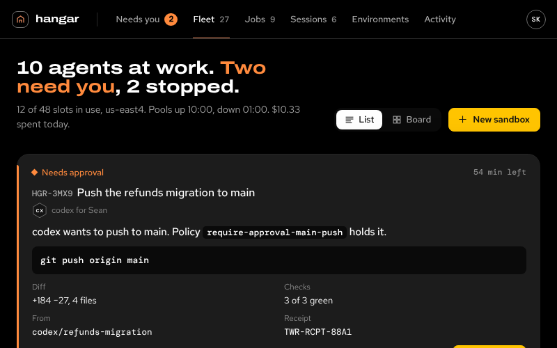
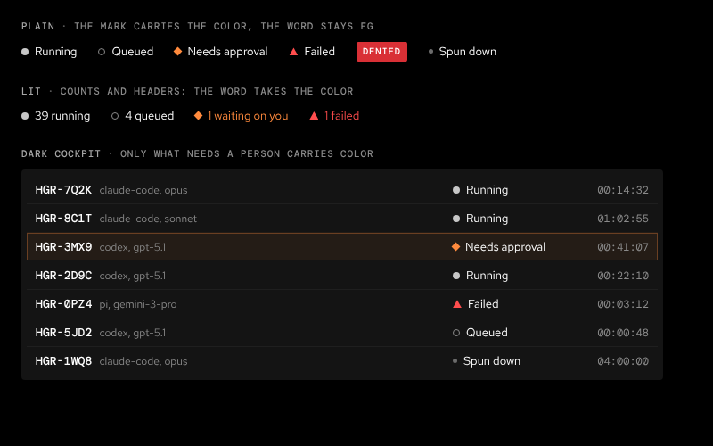
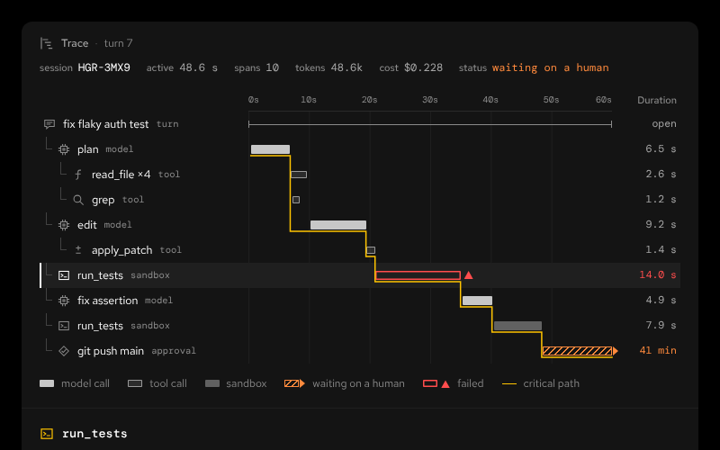

<span class="af-eyebrow">Agent factory · Design</span>

# Airframe

Airframe is the one design system for every tool in the suite: the hangar console, Tower, the five docs sites, the deck and the diagrams. It works like a dark cockpit. The screen stays black, white and grey while agents work, and color appears only when something needs a person.

[Open the component gallery](gallery/){ .md-button .md-button--primary } [Install it](#install-it){ .md-button }

## See it

<figure class="af-figure af-figure--lead">
<a href="components/FleetConsole/"></a>
<figcaption>The Fleet console. Ten agents work in grey. The two that need a person are the only color on the screen, and the one yellow button is the action that is yours.</figcaption>
</figure>

<div class="af-comps">
<a class="af-comp" href="components/Status/"><span class="af-comp__pic"></span><span class="af-comp__head"><b>Status</b><span class="af-comp__group">Foundations</span></span><span class="af-comp__sub">Six statuses, each a color, a shape and a word</span></a>
<a class="af-comp" href="components/TraceSpans/"><span class="af-comp__pic"></span><span class="af-comp__head"><b>TraceSpans</b><span class="af-comp__group">Data</span></span><span class="af-comp__sub">A span tree and timeline with the critical path</span></a>
</div>

These are three of 40 components. [Components](components.md) indexes all of them, and the [gallery](gallery/) renders each one live in Night and Day.

## The rules

<div class="af-rules">
  <div class="af-rule"><b>Quiet until a human is needed</b><span>Running is a grey dot. Only needs approval (orange diamond), failed (red triangle) and denied (red placard) carry color. A screen with no color on it means nobody is needed.</span></div>
  <div class="af-rule"><b>Yellow is your action, never a status</b><span>The brand fill marks the primary action, focus and the trace's critical path. Selection is neutral. Caution is orange so it can never be mistaken for it.</span></div>
  <div class="af-rule"><b>Edge, mark, word</b><span>Cards are a raised tone with soft corners and no border. What needs a person keeps that ground and gains a 3px status edge, the mark and the word. Nothing is tinted.</span></div>
  <div class="af-rule"><b>Color, shape and a word</b><span>Every status has all three, so it reads in grayscale, for color-blind readers and on a projector.</span></div>
  <div class="af-rule"><b>Three faces</b><span>Archivo Expanded for headlines, Red Hat Text for reading, labels and buttons, DM Mono for IDs, numbers and commands. Numbers use tabular figures.</span></div>
  <div class="af-rule"><b>Keyed data</b><span>Metadata reads <code>Policy require-approval-main-push  Model gpt-5.1</code>: a small sentence-case key, then the value. Never "a · b · c".</span></div>
</div>

Two themes share every component: **Night** (`dark`, the default, true black) and **Day** (`light`, paper grey, white cards). The [brand book](guide/brand.md) holds the full rules for voice, color, type and layout.

## Install it

One command copies the tokens, the `af-` classes and the icon sprite into `airframe/` in any project. The [Registry](registry.md) page lists the other items and how to pin a release.

```sh
npx shadcn@latest add https://sean-koval.github.io/agent-factory/r/airframe.json
```

Load the two stylesheets, set the theme on `<html>` and build with the classes. With no `data-theme`, Day follows the reader's OS setting and Night is the fallback.

```html
<html data-theme="dark">
<link rel="stylesheet" href="airframe/airframe.css">
<link rel="stylesheet" href="airframe/airframe-components.css">

<article class="af-card">
  <div class="af-card__top">
    <span class="af-lbl">Sandbox<span class="af-lbl__sub">us-east4</span></span>
    <span class="af-status af-status--approval"><i class="af-status__mark"></i>Needs approval</span>
  </div>
  <span class="af-id">HGR-3MX9</span>
  <div class="af-card__foot"><span>Held <b>41 min</b></span><button class="af-btn af-btn--primary af-btn--sm">Review</button></div>
</article>
```

### What a tool loads

Every file is built into [`theme/`](https://github.com/Sean-Koval/agent-factory/tree/main/theme). A tool vendors the ones it needs at a tagged version and never edits them.

| File | What it is | Who loads it |
| --- | --- | --- |
| `airframe.css` | Every token as `--af-<name>`, Night and Day. | Everything |
| `airframe-components.css` | The `af-` classes for every component, plus the fonts. | Consoles and web apps |
| `airframe-icons.svg` | The icon sprite. See [Icons](icons.md). | Consoles and web apps |
| `airframe.js` | Optional. One ES module with no dependencies: markup helpers and the toast, confirm, drawer and decision-deck behaviours. | Consoles and web apps |
| `airframe-docs.css` | Maps the docs theme (Zensical or Material) onto the tokens. | Docs sites |
| `airframe-suite.html`, `airframe-footer.html` | The suite strip above the docs header and the shared footer, as template partials. | Docs sites |
| `airframe-tokens.json` | Tokens resolved per theme, for scripts that draw diagrams, decks and charts. | Build scripts |

## The docs sites

Every product's docs site is Material for MkDocs or Zensical with four vendored files and a few lines of config. The five sites share one header, one home hero, one footer and the suite strip that links them.

1. Vendor `airframe.css`, `airframe-docs.css`, `airframe-suite.html` and `airframe-footer.html` with `scripts/sync-airframe.sh theme-vN`. The stylesheets go to `docs/stylesheets/` and the partials to `overrides/partials/`.
2. In `mkdocs.yml`, set `theme.logo` and `theme.favicon` to the product's `mark.svg` and `favicon.svg` from [`brand/`](https://github.com/Sean-Koval/agent-factory/tree/main/brand).
3. Load `airframe.css`, `airframe-docs.css` and the site's own one-line `product.css` in `extra_css`. Set `theme.custom_dir: overrides`, and name the product with `extra.airframe.product: hangar`.
4. Add `overrides/main.html`, the one template a site owns.

```css
/* product.css */
:root, [data-md-color-scheme] { --af-product: var(--af-product-hangar); }
```

```jinja
{# overrides/main.html #}



```

The home page is an `af-hero`: an `af-eyebrow`, one display headline, one `af-lede` and two `md-button`s, one of them primary. With `af-hero--visual`, a `figure.af-hero__visual` holds a real capture of the product. Every other page is a title, a one-sentence lede, sections and a "See also" list. [See each pattern live](docs-sites.md).

## Change it

This repository is the single source of truth. Every value is a token in [`airframe/tokens.json`](https://github.com/Sean-Koval/agent-factory/blob/main/airframe/tokens.json) and every component is a class in [`airframe/styles/`](https://github.com/Sean-Koval/agent-factory/tree/main/airframe/styles). A tool never invents its own palette, and a test in each tool repo fails on a hard-coded color. Each repo's `AGENTS.md` points coding agents here first.

1. Change a value in `airframe/tokens.json` or a component in `airframe/styles/`.
2. Run `python3 scripts/airframe.py build` to regenerate `theme/`.
3. Run `python3 scripts/airframe.py check`. CI runs it too. It fails on a stale `theme/`, a color literal or a `var(--af-*)` that is not a token.
4. Add a `## theme-vN` entry to [`theme/CHANGELOG.md`](https://github.com/Sean-Koval/agent-factory/blob/main/theme/CHANGELOG.md) listing each changed token. The `theme` workflow refuses a theme change without one.
5. Merge. That tags `theme-vN` and opens a sync pull request in hangar, flightdeck, ai-dlc and Tower, or prints the one command: `sh scripts/theme_sync.sh theme-vN`.

Token names are a contract: rename only with an alias. The theme-v1 names (`--af-st-appr`, `--af-p-hangar`, `--af-f-mono` and the rest) still resolve, and new code uses the full names.

## Where to go next

- **[Tokens](tokens.md)**: every color, type style, space and radius, with what each is for.
- **[Components](components.md)**: the 40 components by group, each with its contract and markup.
- **[Icons](icons.md)**: the 57 icons and how to place one.
- **[Registry](registry.md)**: every installable item, including the skill that keeps coding agents on Airframe.
- **[Brand book](guide/brand.md)**: voice, [status](guide/status.md), [data](guide/data.md) and [products](guide/products.md).

Airframe also draws the deck (`python3 scripts/build_deck.py --pdf` rebuilds it) and the diagrams. Both read the tokens, so an inlined diagram follows the page theme. The Design System page on claude.ai shows the same components for design reviews; when it and this repository disagree, this repository wins.
