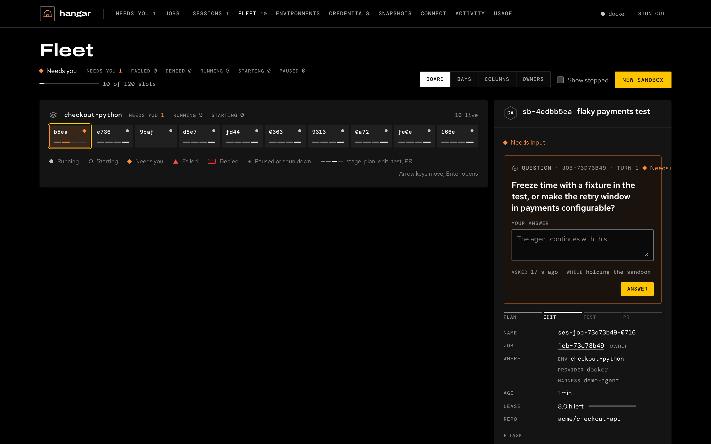

---
hide:
  - navigation
  - toc
---

Agent factory · team tooling

# Hand work to cloud coding agents and keep every change reviewable

Tools that let a team of six engineers run about sixty agent sessions at once. Four planes: the team harness defines what the agents run, hangar runs them, flightdeck judges the runs and Tower governs risky decisions. ai-dlc sets up the people and machines around them, and every change still leaves through a reviewed pull request.

[See how it fits](how-it-fits.md){ .md-button .md-button--primary } [Open the deck](deck.md){ .md-button }

<figure class="af-hero__visual">

<figcaption>hangar's Fleet, from its demo: ten agents, one needs you</figcaption>
</figure>

  <a class="af-tool" href="team-harness/"><small>Define</small><b>Team harness</b>The harness as native files and a lock, frozen from a good run and promoted on evidence.</a>
  <a class="af-tool" href="tools/hangar/" style="--af-tool: var(--af-product-hangar)"><small>Run</small><b>hangar</b>Runs coding agents in isolated cloud sandboxes, from a ticket to a landed PR.</a>
  <a class="af-tool" href="tools/flightdeck/" style="--af-tool: var(--af-product-flightdeck)"><small>Judge</small><b>flightdeck</b>Judges harness changes with paired statistics and behavior specs over every run.</a>
  <a class="af-tool" href="tools/workspace/" style="--af-tool: var(--af-product-tower)"><small>Govern</small><b>Tower</b>One decision point for risky actions: rules, human approvals, signed receipts.</a>
  <a class="af-tool" href="tools/ai-dlc/" style="--af-tool: var(--af-product-aidlc)"><small>Setup</small><b>ai-dlc</b>Sets up engineers' machines, authors the optional workflow plugin, gates local work on CI.</a>

Also in the suite: [Spaceport](tools/spaceport.md), reviewed data products that agents query through four MCP tools (frozen), and [Airframe](airframe/index.md), the design system every tool uses.

## A ticket's journey

1. An engineer moves ABC-123 to **Ready for agent** in Jira.
2. hangar receives the signed webhook, marks the job tainted (ticket text is untrusted) and admits it within budget and reviewer capacity.
3. hangar claims a sandbox from `team-default@stable` and records a manifest carrying its `harness_digest`. Every step streams into a trace.
4. When the agent needs something risky, hangar asks Tower: allow, deny or wait. A wait goes to someone other than the requester, and every answer has a signed receipt.
5. hangar runs the repo's own checks, pushes one commit through its gateway and opens a draft PR. A second human approves that exact commit.
6. The finished run lands once in the outbox, and flightdeck compacts it to Parquet overnight.
7. When someone changes the harness, flightdeck runs stable against candidate on pinned trials and posts the verdict on the harness PR. A different person moves `stable`.

The diagram, which tool owns what, every seam and its status: [How it fits](how-it-fits.md).

## Start here

- **Engineer:** [hangar](tools/hangar.md). `hangar connect` adds hangar to your agent client ([connecting clients](https://sean-koval.github.io/hangar/clients/)).
- **Harness owner:** [Team harness](team-harness.md). Copy the example, freeze a good run, and promote on evidence.
- **Running it at work:** [Run the factory at your company](work/index.md). The four-repo convention, change sets from a ticket to a deploy, and what stays yours.
- **Building UI:** [Airframe](airframe/index.md). Tokens, components and the rules every tool's UI follows.

## The four planes

<figure class="af-figure">
--8<-- "planes.svg"
<figcaption>The four planes, the doors and the gate · <a href="assets/diagrams/planes.svg">full size</a></figcaption>
</figure>

Define is the team harness repo, Run is hangar, Judge is flightdeck and Govern is Tower. hangar sits in the middle. Work arrives through the doors, the harness arrives as a lock file, risky decisions go out to Tower, every run goes out to flightdeck, and flightdeck's verdict comes back as the next promoted harness. One number, `harness_digest`, identifies a harness from the lock file to the manifest, the PR and the report. ai-dlc is setup, off the agent's hot path: it prepares machines, authors the optional workflow plugin the harness may pin, and gates local work on CI.

## Three rules the suite is built around

**Many doors, one inbox, one gate.** People start work wherever they already are: a Jira status, a GitHub label, Slack, an MCP client. Questions and approvals come back to one inbox, and nothing reaches a branch except through a pull request a human approves.

**Each tool owns one plane.** hangar never analyses runs, flightdeck never runs sandboxes, Tower decides but never enforces, and ai-dlc stays off the agent's hot path. They meet only at versioned [contracts](architecture/contracts.md).

**Fail closed, measure everything.** Untrusted input taints a run and raises the bar to land it. Every run is written once to an outbox, so a harness change is judged on paired evidence rather than impressions.

## Where to go next

- [How it fits](how-it-fits.md): the journey as a diagram, who owns what, and every seam with its status.
- [Architecture](architecture/index.md): the system context, the containers and where they run.
- [Flows](architecture/flows.md): a ticket to a merged PR, improving the harness, a risky action, the nightly pipeline, onboarding a repo.
- [Roadmap](roadmap.md): the four phases and their themes, with progress rebuilt daily from GitHub issues.
- [Decisions](decisions.md): choices that span more than one repo.
- [Glossary](glossary.md): the suite's terms, defined once.

hangar, flightdeck and ai-dlc are open source. Tower and Spaceport are private repositories for now.
