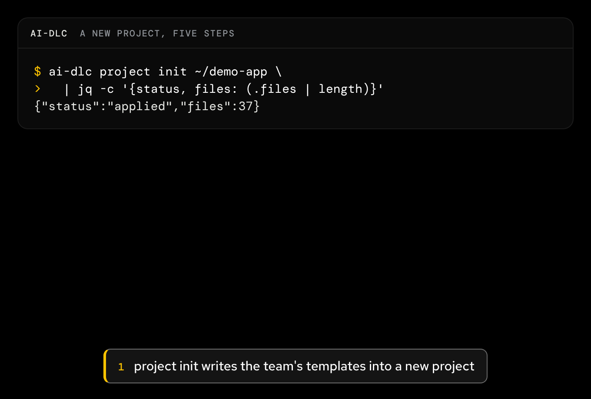

---
hide:
  - navigation
  - toc
---

Agent factory · Suite

# Hand work to cloud coding agents and keep every change reviewable

Six engineers, about sixty agent sessions at once. The suite defines what the agents run, runs them in cloud sandboxes, judges every run and holds risky actions for a person. Every change still leaves through a pull request a human approves.

[See how it fits](how-it-fits.md){ .md-button .md-button--primary } [Open the deck](deck.md){ .md-button }

<figure class="af-hero__visual">

<figcaption>hangar's Fleet: one decision at a time. A push to main waits for you; the agents keep working.</figcaption>
</figure>

  <a class="af-tool" href="team-harness/"><small>Define</small><b>Team harness</b>The harness as native files and a lock, frozen from a good run and promoted on evidence.</a>
  <a class="af-tool" href="tools/hangar/" style="--af-tool: var(--af-product-hangar)"><small>Run</small><b>hangar</b>Runs coding agents in isolated cloud sandboxes, from a ticket to a landed PR.</a>
  <a class="af-tool" href="tools/flightdeck/" style="--af-tool: var(--af-product-flightdeck)"><small>Judge</small><b>flightdeck</b>Judges harness changes with paired statistics and behavior specs over every run.</a>
  <a class="af-tool" href="tools/workspace/" style="--af-tool: var(--af-product-tower)"><small>Govern</small><b>Tower</b>One decision point for risky actions: rules, human approvals, signed receipts.</a>
  <a class="af-tool" href="tools/ai-dlc/" style="--af-tool: var(--af-product-aidlc)"><small>Setup</small><b>ai-dlc</b>Sets up engineers' machines, authors the optional workflow plugin, gates local work on CI.</a>

Two more parts sit under the planes. [Spaceport](tools/spaceport.md) is the data capability: reviewed data products that agents query through four MCP tools (frozen). [Airframe](airframe/index.md) is the design system every tool's UI uses.

## Watch each tool work

Four clips, each under 20 seconds. Select a frame to play its clip.

<figure class="af-figure af-figure--lead">

<figcaption><b>hangar.</b> An issue becomes a job, the push to main waits for a person, and the PR lands.</figcaption>
</figure>
<figure class="af-figure af-figure--lead">

<figcaption><b>Tower.</b> A push to main waits on an approver's Desk. A tech lead denies it, and the receipt carries the reason.</figcaption>
</figure>
<figure class="af-figure af-figure--lead">

<figcaption><b>flightdeck.</b> Two arms compared in a terminal, then the verdict as a comment on the pull request.</figcaption>
</figure>
<figure class="af-figure af-figure--lead">

<figcaption><b>ai-dlc.</b> The quickstart in a fresh project, ending with its required checks passing.</figcaption>
</figure>

## How the planes connect

<figure class="af-figure af-planes--wide">
--8<-- "planes.svg"
<figcaption>Work enters through the doors, hangar runs it, Tower decides, flightdeck judges, and the pull request is the one way out · <a href="assets/diagrams/planes.svg">full size</a></figcaption>
</figure>

<figure class="af-figure af-planes--stacked">
--8<-- "planes-stacked.svg"
<figcaption>The four planes, one above the other · <a href="assets/diagrams/planes.svg">the wide drawing</a></figcaption>
</figure>

hangar sits in the middle. Work arrives through the doors and the harness arrives as a lock file. Risky decisions go out to Tower and every run goes out to flightdeck. The verdict comes back as the next promoted harness.

One value, `harness_digest`, identifies a harness from the lock file to the manifest, the PR and the report. ai-dlc stays off the agent's hot path: it prepares machines, authors the optional workflow plugin and gates local work on CI.

[Follow one ticket through the planes](how-it-fits.md){ .md-button }

## Start where you work

  <a class="af-tool" href="tools/hangar/"><small>Engineer</small><b>Hand off a ticket</b><code>hangar connect</code> adds hangar to your agent client. A ticket or a label starts a job.</a>
  <a class="af-tool" href="team-harness/"><small>Harness owner</small><b>Shape the harness</b>Copy the example, freeze a good run, and promote on evidence.</a>
  <a class="af-tool" href="work/"><small>Platform engineer</small><b>Run it at your company</b>The four-repo convention, change sets from a ticket to a deploy, and what stays yours.</a>
  <a class="af-tool" href="airframe/"><small>UI builder</small><b>Build with Airframe</b>Tokens, components and the rules every tool's UI follows.</a>

Setting up a client? [Connecting clients](https://sean-koval.github.io/hangar/clients/) covers `hangar connect` for each agent client.

## Go deeper

- [How it fits](how-it-fits.md): one ticket through the four planes, the three rules, and who owns what.
- [Tools](tools/index.md): every tool on one page, with its plane and its docs site.
- [Architecture](architecture/index.md): the system context, the containers and where they run.
- [Flows](architecture/flows.md): improving the harness, a risky action, the nightly pipeline, onboarding a repo.
- [Roadmap](roadmap.md): the four phases and their themes, with counts rebuilt daily from each repo's GitHub milestones.
- [Decisions](decisions.md): choices that span more than one repo.
- [Glossary](glossary.md): the suite's terms, defined once.

hangar, flightdeck and ai-dlc are open source. Tower and Spaceport are private repositories for now.
