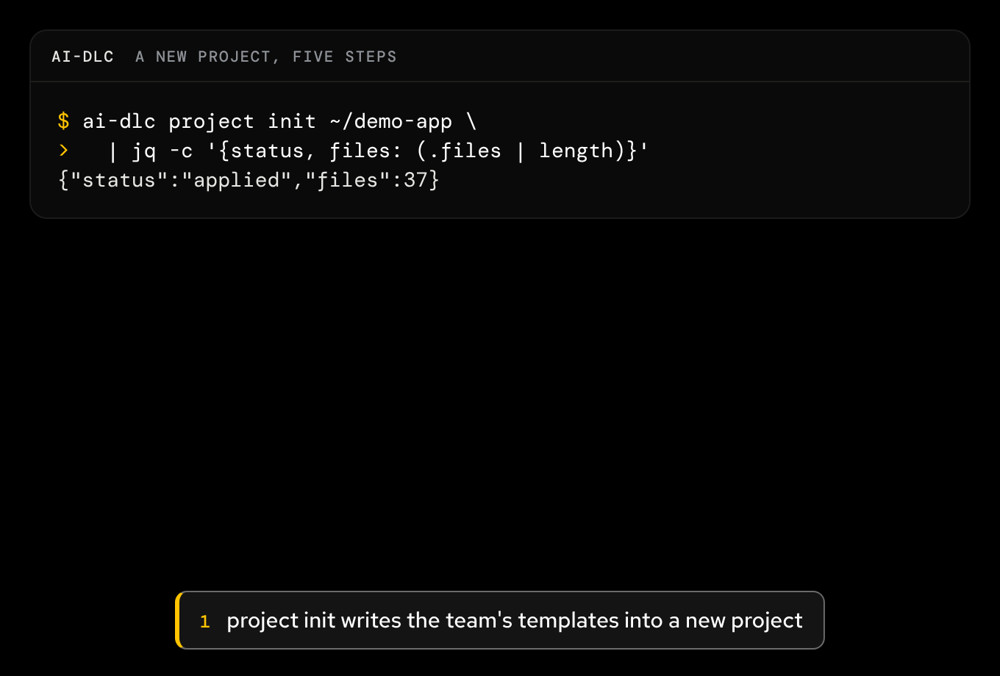

Agent factory · Setup

# ai-dlc

Sets up engineers' machines, authors the optional workflow plugin, gates local work on CI.

<figure class="af-figure af-figure--lead">

<figcaption>Play the clip (18 s): the quickstart's five steps in a fresh project, ending on project check --required passing.</figcaption>
</figure>

ai-dlc is the suite's setup, off the agent's hot path. The [team harness repo](../team-harness.md) defines the harness; ai-dlc contributes one optional component to it, its workflow plugin, and prepares engineers' machines ([ADR 0001](https://github.com/Sean-Koval/ai-dlc/blob/main/docs/decisions/0001-refocus-ai-dlc.md)).

| | |
| --- | --- |
| Owns | The `ai-dlc-workflow` plugin and its digest, machine enrollment and bootstrap, the CI-gated work lifecycle, team skills. |
| Does not own | The harness (the team harness repo), running agents (hangar), evaluation (flightdeck) or tracker intake (hangar's doors). |
| Entry points | The `ai-dlc` CLI, a local MCP server, the plugin. |
| Used by | Each engineer on their own machine, CI, and the team harness repo, which pins the plugin. |
| Status | The plugin, its Codex form, the hooks and the ADR `checks:` convention are shipped; the refocus docs sweep is in progress. Features outside ADR 0001 are frozen. See [P2 on the roadmap](../roadmap.md#p2-adopt-and-capture). |
| Docs site | Live: [sean-koval.github.io/ai-dlc](https://sean-koval.github.io/ai-dlc/) |

[Docs site](https://sean-koval.github.io/ai-dlc/){ .md-button .md-button--primary } [Repository](https://github.com/Sean-Koval/ai-dlc){ .md-button }
