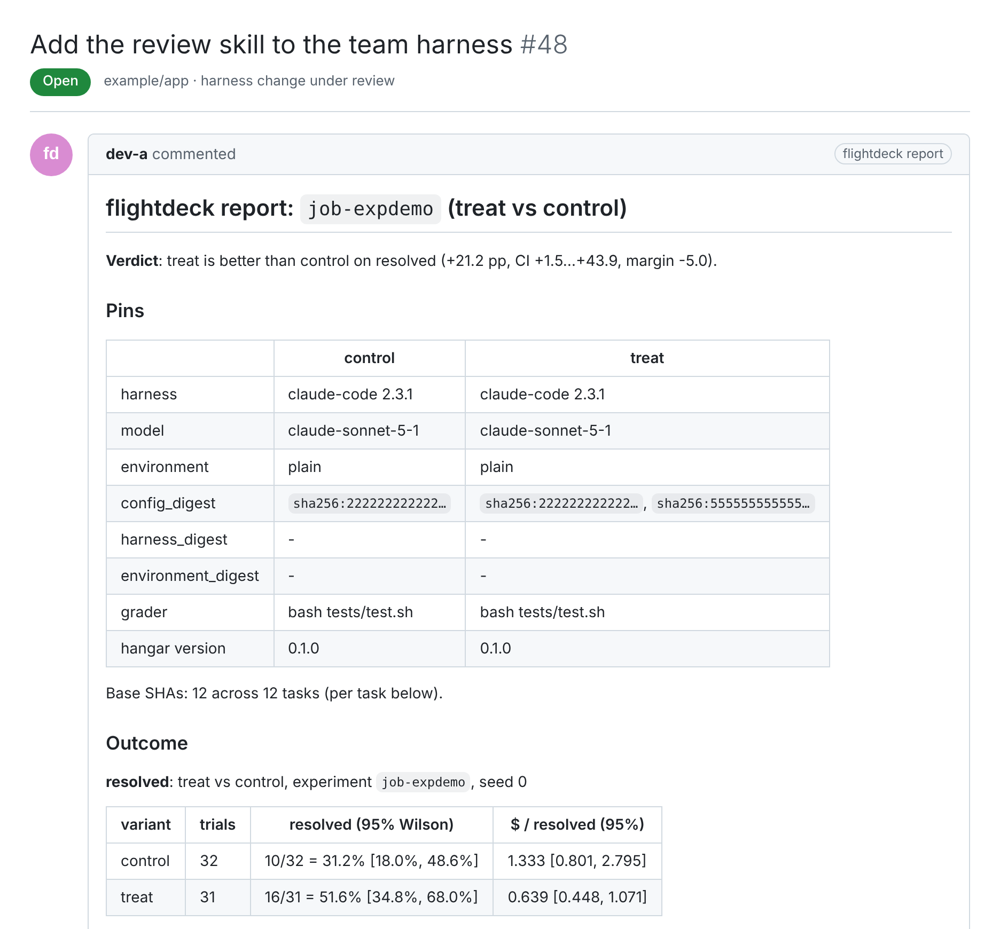

Agent factory · Judge

# flightdeck

Judges harness changes with paired statistics and behavior specs over every run.

| | |
| --- | --- |
| Owns | `flightdeck.parquet/v1` and the nightly compactor, paired statistics (Wilson intervals, pass^k, paired bootstrap, cost per resolved task), behavior specs and nightly ADR checks, task sets and sealed holdouts, the sampling policy for trials, experiment submission and reports. |
| Does not own | Sandboxes, credentials or provider code. It never reads hangar's database; it reads exports and the outbox. |
| Entry points | The `flightdeck` CLI; reports posted as GitHub comments; a nightly `check run`. |
| Used by | The harness owner and lead deciding promotions, engineers reading reports on harness PRs, nightly CI. |
| Status | **Shipped:** the data plane, ingest and the compactor ([#4](https://github.com/Sean-Koval/flightdeck/issues/4), [#5](https://github.com/Sean-Koval/flightdeck/issues/5), [#7](https://github.com/Sean-Koval/flightdeck/issues/7)), statistics and reports ([#8](https://github.com/Sean-Koval/flightdeck/issues/8), [#9](https://github.com/Sean-Koval/flightdeck/issues/9)), the task format ([#10](https://github.com/Sean-Koval/flightdeck/issues/10)), the experiment client ([#11](https://github.com/Sean-Koval/flightdeck/issues/11)), the behavior spec language ([#14](https://github.com/Sean-Koval/flightdeck/issues/14)), weekly metrics ([#6](https://github.com/Sean-Koval/flightdeck/issues/6)). **In progress:** the nightly spec runner ([#15](https://github.com/Sean-Koval/flightdeck/issues/15)), the pin-set trials client ([#25](https://github.com/Sean-Koval/flightdeck/issues/25)), the regression suite ([#12](https://github.com/Sean-Koval/flightdeck/issues/12)) and one real decision ([#20](https://github.com/Sean-Koval/flightdeck/issues/20)). |
| Docs site | Live: [sean-koval.github.io/flightdeck](https://sean-koval.github.io/flightdeck/) |

[Docs site](https://sean-koval.github.io/flightdeck/){ .md-button .md-button--primary } [Repository](https://github.com/Sean-Koval/flightdeck){ .md-button }

<figure class="af-figure">

<figcaption>The verdict on the harness PR, rendered by flightdeck's docs/assets/build.py from the fixture experiment</figcaption>
</figure>

