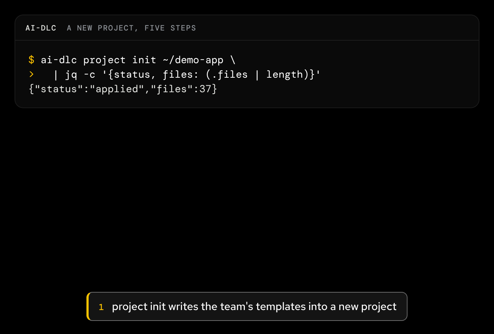

# Tools

Five tools and the team harness repo, each with one job. Four of them own a plane: the team harness is Define, hangar is Run, flightdeck is Judge and Tower is Govern.

ai-dlc is Setup, off the agent's hot path, and Spaceport sits under the suite as a frozen data capability.

<a class="af-tile" href="hangar/"><small>Run</small><strong>hangar</strong> A held push waits for a person.</a>
<a class="af-tile" href="flightdeck/"><small>Judge</small><strong>flightdeck</strong> The verdict on a harness pull request.</a>
<a class="af-tile" href="workspace/"><small>Govern</small><strong>Tower</strong> An approval on an approver's Desk.</a>
<a class="af-tile" href="ai-dlc/"><small>Setup</small><strong>ai-dlc</strong> A project set up from the terminal.</a>

## The suite at a glance

| Tool | Plane | In one line | Status | Docs site |
| --- | --- | --- | --- | --- |
| [Team harness](../team-harness.md) | Define | The harness as native files and a lock, frozen from a good run and promoted on evidence. | Example shipped; the team's repo next | [README](https://github.com/Sean-Koval/team-harness) |
| [hangar](hangar.md) | Run | Runs coding agents in isolated cloud sandboxes, from a ticket to a landed PR. | Shipped; asking Tower in progress | [Live](https://sean-koval.github.io/hangar/) |
| [flightdeck](flightdeck.md) | Judge | Judges harness changes with paired statistics and behavior specs over every run. | v0 shipped; one real decision next | [Live](https://sean-koval.github.io/flightdeck/) |
| [Tower](workspace.md) | Govern | One decision point for risky actions: rules, human approvals, signed receipts. | Decision API shipped; passports and inbox next | Private |
| [ai-dlc](ai-dlc.md) | Setup | Sets up engineers' machines, authors the optional workflow plugin, gates local work on CI. | Plugin shipped; refocus docs in progress | [Live](https://sean-koval.github.io/ai-dlc/) |
| [Spaceport](spaceport.md) | Capability | Reviewed data products that agents query through four MCP tools. | Frozen | README only |

hangar, flightdeck and ai-dlc are public and have docs sites in the same theme. Tower and Spaceport are private repositories for now. Each status is tracked on the [roadmap](../roadmap.md).

## Start from what you want to do

- **Hand a ticket to an agent and get a PR back.** [hangar](hangar.md) runs the job in a sandbox and brings questions and approvals to one inbox.
- **Change how the agents work.** The [team harness](../team-harness.md) holds the instructions, skills, hooks and pins; a change ships as a candidate channel.
- **Decide whether that change is better.** [flightdeck](flightdeck.md) compares candidate with stable and posts the verdict on the PR.
- **Put a second person in front of risky actions.** [Tower](workspace.md) answers allow, deny or wait, and signs a receipt.
- **Prepare an engineer's machine.** [ai-dlc](ai-dlc.md) enrolls it and authors the optional workflow plugin.
- **Run all of it at your company.** [At work](../work/index.md) is the runbook, from four repos to a deployed change.

## What every tool page shows

Each page leads with the product on screen, then its status, what it owns and what it doesn't, and the tools it works with. [How it fits](../how-it-fits.md) follows one ticket through all of them.
