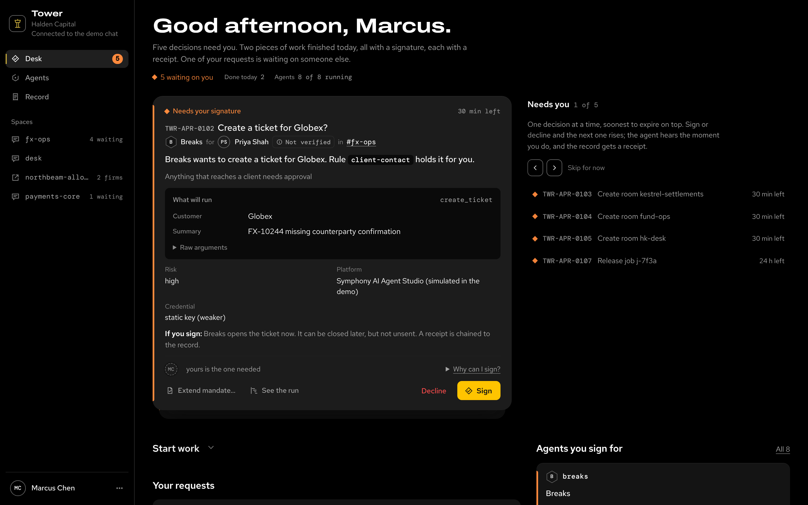

Agent factory · Govern

# Tower

One decision point for risky actions: rules, human approvals, signed receipts.

Tower is the team's governance plane for the coding agents hangar runs and the vendor agents the team uses. It was called the governed workspace until the owner named it Tower (Tower ADR 0017). Hangar runs the agents; Tower clears risky actions.

| | |
| --- | --- |
| Owns | Cedar rules, approvals where the approver is never the requester, RFC 8693 passports, hash-chained receipts and their attestation, reconciliation of tool calls against receipts, an approvals inbox. |
| Does not own | Enforcement inside sandboxes or landing mechanics. Tower decides; hangar enforces. |
| Entry points | The REST decision API `POST /v1/decisions` (on main), an MCP gateway, a Claude Code hook (`/hooks/claude-code`), a web inbox. |
| Used by | Approvers and leads, hangar's decision client, auditors. |
| Status | **Shipped:** the decision API (Tower#13), signed approval events with an outbox (Tower#17), attestation receipts (Tower#18), approver ≠ requester with a low-risk self-approval rule (Tower#19), passports for `/mcp`. **Next:** passports on `/hooks` (Tower#14), the inbox feed for hangar's Slack digest (Tower#21), and a deployment next to hangar's control plane (Tower#28, #52). hangar's side of the wiring is [hangar#172](https://github.com/Sean-Koval/hangar/issues/172), [#173](https://github.com/Sean-Koval/hangar/issues/173) and [#190](https://github.com/Sean-Koval/hangar/issues/190). |
| Docs site | Private repository (Sean-Koval/tower); docs site once public. |

<figure class="af-figure">

<figcaption>The Desk, captured from Tower's offline demo by scripts/captures.py</figcaption>
</figure>

## How hangar uses Tower

Hangar enforces; Tower decides. Each of hangar's enforcement points asks Tower one question and keeps doing the rest itself. An allow lets hangar go on with its own checks, never skip them, and anything that fails on the way is a wait or a deny.

| Hangar enforcement point | What it asks Tower | What stays in hangar |
| --- | --- | --- |
| Job intake | May this untrusted job run? (`hangar.job.release`) | The queue, budgets, fairness, the power schedule |
| Driver `ask` turns and the sandbox hook | May this risky tool call run? (`hangar.tool.call`; the sandbox's Claude Code hook asks `/hooks/claude-code`, with a passport once Tower#14 lands) | Taint tracking, and which calls count as risky |
| Egress proxy and secret broker | May this blocked host or missing secret be granted? (`hangar.egress.request`, `hangar.secret.request`) | The proxy, NetworkPolicy, the git gateway, intake posture |
| Landing | Does this approval of this head land it? (`hangar.landing.approve`) | Auto-merge, SHA pinning, the stale-gate, branch protection |

Each kind rolls out on its own: `off` (hangar's own rules, the default), then `shadow` (Tower answers dry runs and disagreements are counted), then `enforce`. The contract is `hangar.decision/v1`, in hangar's [spec 0015](https://github.com/Sean-Koval/hangar/blob/main/docs/specs/0015-governance-decision-point.md).
